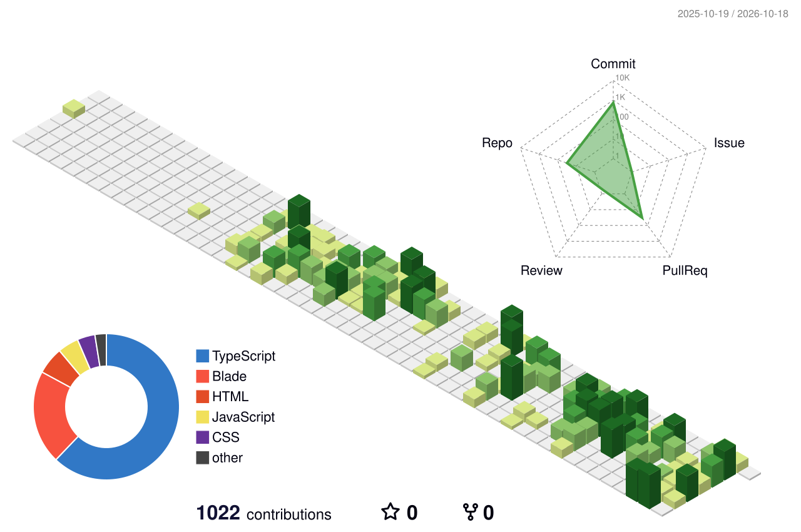

<h1 align="center">Usama Munawar</h1>

  <strong>Full-stack product engineer. I ship websites and apps built to last.</strong> 
  React · React Native · Node.js · Laravel/PHP · VoIP/Asterisk · automation · AI

  <a href="https://www.chaudharyusama.com">Portfolio</a> ·
  <a href="https://www.chaudharyusama.com/book">Book a 30-minute call</a> ·
  <a href="mailto:devusamaworks@gmail.com">Email</a> ·
  <a href="https://www.linkedin.com/in/usama-works/">LinkedIn</a> ·
  <a href="https://www.upwork.com/freelancers/~01007bf0a0286da654">Upwork</a> ·
  <a href="https://www.fiverr.com/ch_usama_">Fiverr</a> ·
  <a href="https://www.chaudharyusama.com/usama-munawar-cv.pdf">CV (PDF)</a>

---

I'm a full-stack engineer in Lahore with 5+ years of production work. I take products from idea to launch and keep them running: the web app, the mobile app, the API and the servers behind them. I work remotely with clients in Ireland, Belgium, South Africa and Pakistan.

- **Top Rated Plus on Upwork**, 5.0 from 47 reviews
- **Level 2 Seller on Fiverr**, 4.9 from 89 reviews
- Enterprise SaaS products serving 10K+ users
- Asterisk call platforms running 40+ agent call centres

## What I build

- **[Laravel SaaS backends](https://www.chaudharyusama.com/services/laravel-development)**: multi-tenant apps with billing, roles, queues and APIs other companies depend on.
- **[VoIP and call platforms](https://www.chaudharyusama.com/services/voip-asterisk)**: Asterisk dialers, IVRs, call routing and reporting for call centres.
- **[Automation with n8n](https://www.chaudharyusama.com/services/automation-n8n)**: back-office workflows that replace manual copy-and-paste work.
- **[AI features](https://www.chaudharyusama.com/services/ai-integration)**: LLM, RAG and agent features inside real products.
- **[MVPs, idea to launch](https://www.chaudharyusama.com/services/mvp-development)**: the first version worth building, scoped, built and shipped fast.

## Selected work

| Project | What it does | Built with |
| --- | --- | --- |
| [Tavora](https://www.chaudharyusama.com/project/15) ([code](https://github.com/CH-USAMA/tavora)) | Luxury watch store with WhatsApp checkout and a self-service admin panel | Next.js, TypeScript, Drizzle, Turso |
| [Solutions Zilla Call Portal](https://www.chaudharyusama.com/project/4) | Call-centre management with AI analytics and call routing | Laravel, Next.js, MySQL |
| [iSmart Clinic](https://www.chaudharyusama.com/project/21) | Multi-tenant clinic SaaS with WhatsApp reminders, role-based access and audit logs | Laravel, Next.js, PostgreSQL |
| [HoboTech VAPT Portal](https://www.chaudharyusama.com/project/14) | Turns a penetration-test PDF into findings and tracks each one to remediation | Next.js, Prisma, PostgreSQL, BullMQ |
| [Focus Interiors](https://www.chaudharyusama.com/project/5) | Interior design store with AI recommendations and automated SEO | Shopify, React, OpenAI |
| [Afrosource Belgium](https://www.chaudharyusama.com/project/19) | Multilingual B2B drinks catalogue with 1,600+ products and volume pricing | WordPress, WooCommerce |

[All case studies →](https://www.chaudharyusama.com/projects)

## Free tools

Small tools for founders and developers. No sign-up, everything runs in your browser, in English, Arabic and French:
[AI Prompt Builder](https://www.chaudharyusama.com/tools/prompt-builder) ·
[MVP Scope Planner](https://www.chaudharyusama.com/tools/mvp-planner) ·
[AI API Cost Calculator](https://www.chaudharyusama.com/tools/ai-cost-calculator) ·
[GitHub README Generator](https://www.chaudharyusama.com/tools/readme-generator)

## Stack

  
   
  

Also: React Native, Asterisk, n8n, OpenAI and other LLM APIs, Pinecone, Firebase, WordPress and WooCommerce, Shopify.

## Contributions

<picture>
  <source media="(prefers-color-scheme: dark)" srcset="./profile-3d-contrib/profile-night-rainbow.svg" />
  <source media="(prefers-color-scheme: light)" srcset="./profile-3d-contrib/profile-green-animate.svg" />
  
</picture>

---

  Have something to build? <a href="https://www.chaudharyusama.com/book">Book a 30-minute call</a> or write to <a href="mailto:devusamaworks@gmail.com">devusamaworks@gmail.com</a>.

